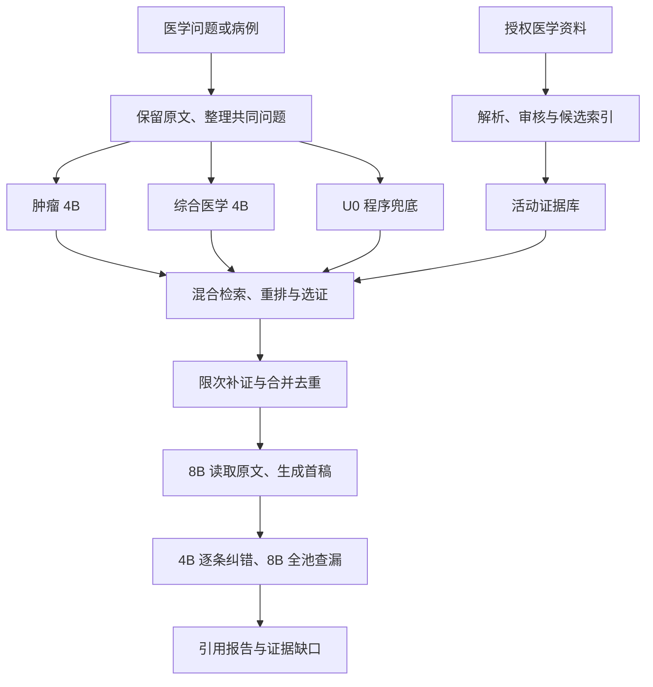

# MedEvidence · 本地医学证据分析

面向医学知识咨询和病例材料分析的本地研究原型。系统从统一的中英文医学资料库取证，由肿瘤与综合医学两路 Agent 分别展开问题，生成带原文引用、来源版本和证据缺口的分析报告。

**架构快照 · 2026-11-15**　|　**公开文档仓库**　|　**研究与工程验证阶段**

## 系统总览

| 模块 | 当前实现 |
| --- | --- |
| 知识库 | 保存原始资料、文档版本、章节、可定位的原文及表格。程序全量初检，按疑点审核及局部恢复，独立验证候选索引。 |
| 混合检索 | BM25 双语医学词项扩展、BGE-M3 向量召回、RRF 融合、BGE 重排，支持按需读取来源上下文。 |
| Agent 取证 | 两路 4B 共享用户原问题并分别规划。U0 是程序检索路径。每个任务首轮从 Top 5 选最多两条，可有一轮定向补检。 |
| 原文预算 | 排序视图 768 token。工作台 4B 输入上限 8,192 token，8B 输入上限 20,480 token。首稿优先整段原文，超限后改用可追溯的原文片段。全池复核可分批。 |
| 最终报告 | 4B 负责逐条纠错，8B 负责首稿、池内查漏及组织通过核验的文字。报告保留出处、适用条件和待核对的问题。 |

## 文档导航

| 要了解什么 | 文档 |
| --- | --- |
| 完整架构、技术栈、模块分工与运行边界 | [系统架构](docs/ARCHITECTURE.md) |
| 自动入库、原文层级、表格、双语检索与发布 | [知识库与检索](docs/KNOWLEDGE_PIPELINE.md) |
| 病例入口、共同问题、三路查询、选证和审核 | [Agent 工作流](docs/AGENT_WORKFLOW.md) |
| 各节点具体 token 上限和超限处理 | [上下文预算](docs/CONTEXT_BUDGETS.md) |
| 当前状态、已知限制和下一步 | [项目上下文](docs/PROJECT_CONTEXT.md) |
| 版本变化及工程验证边界 | [开发记录](docs/DEVELOPMENT_LOG.md) |

## 当前验证范围

2026-11-15 核对的本地活动索引包含 **8,995 份已发布资料和 372,689 条向量**。另外 **542 份资料**留在待复核状态。这次合库经过监督切换。固定 64 题的指定来源命中由旧版 **59/64** 变为新版 **55/64**，自动发布门禁未通过。此指标衡量检索命中，医学回答质量与临床效能仍待单独验证。详见[项目上下文](docs/PROJECT_CONTEXT.md)。

本仓库仅收录架构、计划与脱敏验证记录。工程源码、运行配置、模型权重、知识库和病例资料留在内部环境。后续维护见[贡献说明](CONTRIBUTING.md)。
