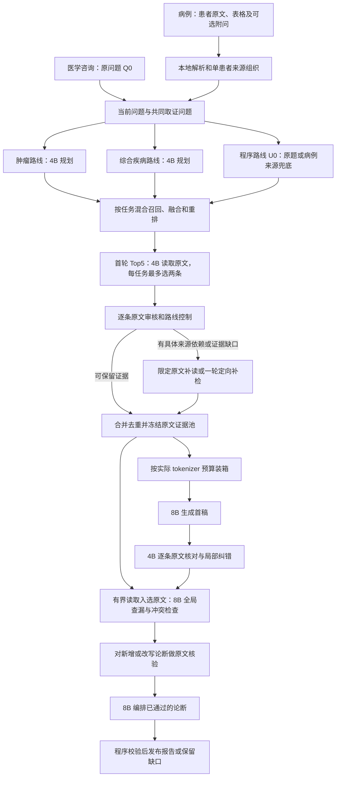

# 医学咨询与病例分析工作流

[项目首页](../README.md) · [总体架构](ARCHITECTURE.md) · [上下文预算](CONTEXT_BUDGETS.md) · [知识库入库](KNOWLEDGE_PIPELINE.md)

本文记录本地工作台配置和源码中已接入的流程。证据检索、来源校验和回答发布可以分别追踪。真实病例适用性、医学结论正确性与临床使用资格需要单独验证。

## 1. 输入如何进入同一条取证链路

| 输入 | 进入取证前的处理 | 原始材料的用途 |
| --- | --- | --- |
| 医学知识咨询，包括用户在问题中自述的背景 | 完整保留原问题 `Q0`，由一次 4B 调用整理可独立理解的共同问题 | `Q0` 用于监督拆分、生成及审核。自述背景以用户陈述保留。 |
| 病例和附问 | 本地解析文件，确认患者范围，组织可用正文和表格。用户附问决定重点，患者原文提供证据适用条件。 | 生成与审核可以核对原文、时间、数值、单位、否定词和表格依赖。 |
| 只有病例 | 先建立患者来源视图，再在明确的默认分析范围内组织取证问题 | 按来源保留原文和定位，缺失信息保留为缺口。 |

一次病例分析只面向已确认的单个患者范围。多患者文件先按来源分区，选择患者后再进入分析。病历和用户对话保存在所属范围内，病例原文与公共文献分别标识，避免把患者陈述当成文献依据。无法核验的解析片段会记录原因。已确认的表格与相关正文可以按来源关系一同读取。

医学咨询可以调用当前会话上一轮和最多三轮语义相关候选。共同问题整理阶段仅在当前表达确实需要补齐指代时使用相关历史，旧回答不作为医学证据。原始问题始终保留，派生问题和查询保留在轨迹中。

## 2. 两条专业路线与原问题检索

- 肿瘤路与综合路共享完整 `Q0` 和共同问题，各自最多生成三个有独立取证价值的任务。当前每任务首轮一条查询，两路共最多六条专业查询。查询可以采用简短问句或有明确关系的短语，保留会改变来源适用性的条件。共同问题帮助导航，两路仍分别规划。
- `U0` 由程序建立。短文本咨询使用完整原问。长咨询先整理可定位的原文单元，能够生成带来源绑定的兜底查询时使用该查询，否则记录跳过原因。病例 `U0` 等待两路规划，再从尚未被覆盖的患者来源组寻找兜底查询。当前调度可将 `U0` 与专业路查询在同一检索批次发送，分别保留任务与证据关系。
- 查询在文献库中通过 BM25、BGE 稠密检索、融合及语义重排取证。关键词通道可用双语医学术语扩展，语义通道可跨语言候选匹配。工作台没有默认把每条查询全文翻译一次。检索共享已发布索引，患者原件仍在私有来源范围内。
- 两路逻辑并行，可经双序列调度共用同一 4B 模型。`U0` 不增加一套模型。检索与模型阶段按资源协调，实际速度需要从运行轨迹读取。

## 3. 证据选择、审核与补证

1. **选择**。首轮每个任务取得重排后的最多五条候选，4B 读取候选原文，选零至两条。一个 `E` 编号代表一条原文来源。同一条原文可支持多个任务，跨路去重同时保留任务绑定。
2. **审核**。4B 读取已选来源的原文，记录所支持的关系、适用范围、限制、原文锚点和局部依赖。路线控制读取结构化回执，决定保留证据、按需补读或定向补检。回执也保留失败原因，供追踪和处理缺口。
3. **按缺口处理**。已发现的明确来源依赖，例如原文引用了定义、表头或脚注，按具体证据和定位补读。缺少任何来源能支持的关系时，才在预算内改写查询或派发补检。患者信息缺失、来源冲突和来源局部缺项分别记录。
4. **补检一轮**。同一轮可包含多个有效任务的请求，受去重、查询预算和工具准入约束。程序按重排顺序从补检候选中接收最多两条新的合格原文，并与该任务首轮已选证据合并。补检新证据进入原文核验范围，链路不再启动第二轮 4B 路线复审。
5. **冻结证据池**。融合三路保留来源，先去重再装箱。轨迹中的全部召回记录用于排查。供生成和终审阅读的证据池包含已准入的原文及补检待核原文，每份来源标出来源 ID、章节或表格位置以及所连接的原问题和任务。

## 4. 生成、终审与报告

完整原文证据能容纳时，8B 使用完整合格原文生成首稿。超过预算时，按可回溯的连续原文跨度装箱，保护与问题直接相关的实体、数值及单位、时间、否定、例外和表格关系。未入窗的原文保留在证据池和轨迹里。完整患者侧原文占用优先预算，详见[上下文预算](CONTEXT_BUDGETS.md)。

首稿完成后，4B 先逐条核对原文，按论断决定保留、局部修订或待核验。8B 再有界分批读取最终入选原文，包括初稿未引用或未入窗但仍在池内的来源。它对照 `Q0` 查漏，标记条件、来源冲突和数值关系中的疑点，可提议有原文依据的新论断。新增或实质修改的论断仍需依据原文核验，8B 随后组织通过的内容。终审仅使用已冻结的来源。碰到证据不足或冲突无法解决时，报告保留有据段落并说明缺口。

最终由程序校验来源编号、任务和引用绑定、原文锚点、已审核论断与段落关系。数字预警可进入模型审核，原文中的角色、单位、时间、条件和对应患者需结合来源核对。工作台提供网页报告和 HTML 导出，显示可用原文出处、位置、证据缺口以及面向排查的阶段轨迹。可获取的模型与节点耗时、用量、搜索次数和上下文核验结果随轨迹记录。

## 5. 合成示例

以下内容只演示工程数据如何传递。报告模板内的编号均为虚构。

> 一份示例附件写有“6 mm”、一个检查日期和“未见某伴随征象”。用户问“这份记录里有哪些原文已经明确，哪些需要和别的材料对照？”

- 病例入口保留原问题、报告日期、对应段落和 `6 mm` 的单位，以及否定原句。多个患者来源归属不明时，先确认范围。
- 共同问题把“报告已经明确的描述”与“对照时必须保留的报告条件”分开。肿瘤路可查询影像报告术语的文献用法，综合路可查询同类记录的对照信息，`U0` 可从尚未覆盖的来源做兜底。每条查询携带与自身目标有关的限制。
- 若 `E1` 只覆盖术语用法，`E2` 还提供需要保留的定义条件，则可分别入池。若 `E2` 明确依赖原文表头，程序持来源定位按需补读。用户的报告数值仍从其对应患者原文引用，不能由文献数值替换。
- 终稿可把“附件写了什么”和“文献解释了什么”组织成连贯段落。附件中未确认、或没有来源支持的事项显示为缺口。
