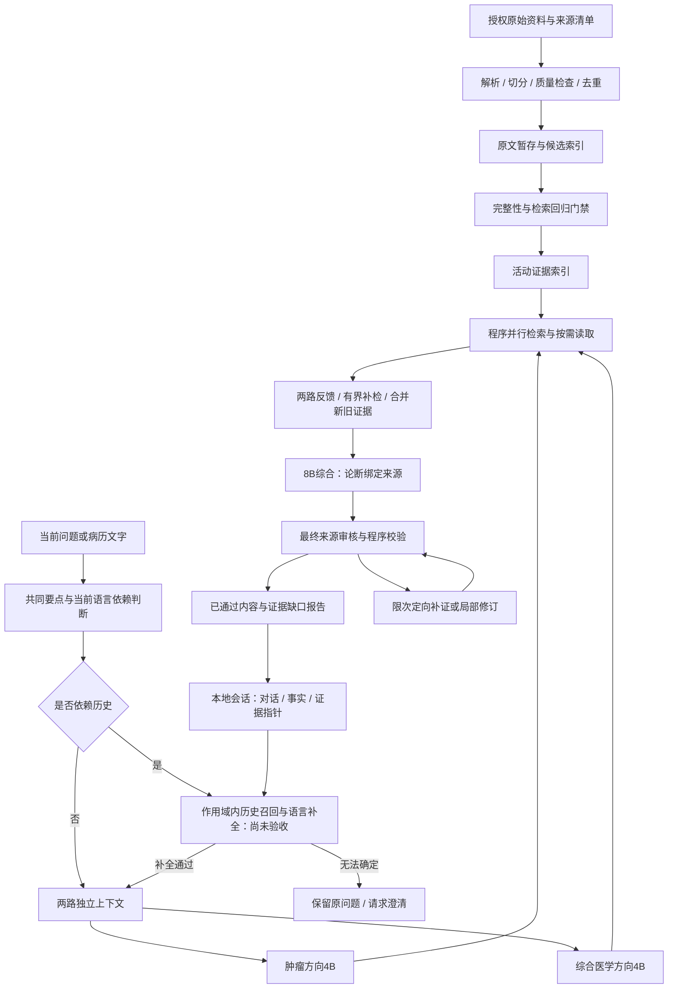
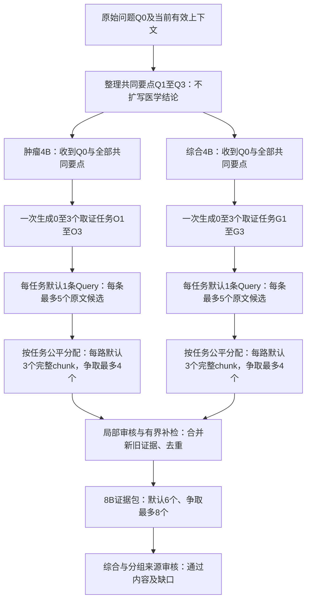
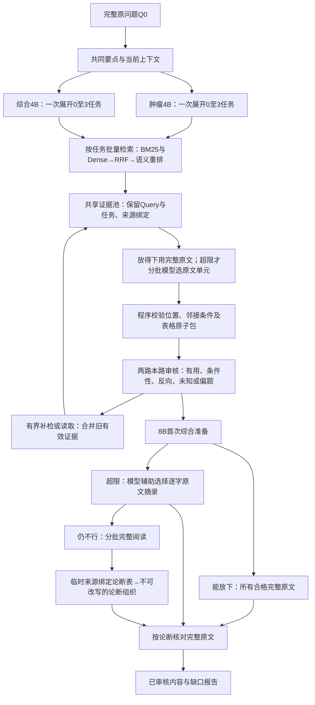

# 技术架构与实现边界

核实日期：2026-10-29。本文描述当前本地研究原型，计划能力另列。状态总览见 [PROJECT_CONTEXT.md](PROJECT_CONTEXT.md)。下述代码路径用于本地核对；当前公开仓库尚未上传这些代码。

## 1. 总体结构

系统由独立的自动入库链路、统一证据检索服务、双路 Agent 工作流和本地报告/会话服务组成。文献库与患者会话隔离，患者内容不自动进入共享知识库。



图中表示逻辑流程；补检和修订有预算，不是无限循环。会话落盘不等于图运行支持任意节点自动恢复。

## 2. 自动入库：保持原文与层级

```text
来源清单 / prepared记录 / 内部收件目录
  → 识别内容格式与来源适配器
  → 不可变快照、来源身份、权限与哈希
  → 本地解析与清洗
  → CanonicalDocument / 章节 / 原文块
  → 段落、表格、表格行检索视图
  → 本地向量编码、全文索引、ANN
  → 候选校验与固定检索回归
  → 原子切换活动代次
```

- 统一入口为 `scripts/run_knowledge_ingestion.ps1` / `scripts/ingest_knowledge.py`，协调器为 `backend/knowledge/guarded_ingestion.py`。
- `source_adapters.py`、`source_stage_one.py`、`hierarchical.py` 等处理不同来源及层级。原生XML/HTML等优先使用结构信息；PDF有本地MinerU及已有恢复适配路径。是否重解析由缓存和签名决定，不是每次全量OCR。
- 文档是来源、版本和权限的管理单元；chunk/表格行是主要检索单元。按章节和段落组织，不能声称所有chunk严格同长。
- 当前默认入库不依赖生成式4B/8B摘要打标，但仍使用解析/OCR及嵌入模型。历史分类实验管线保留，并非全部删除。
- 哈希、解析签名、幂等标识和作用域约束处理重复；这不是全库临床语义去重。
- 质量不合格、失败或待审项目留有阶段、原因与次数；不自动解除隔离。新旧指南语义矛盾需要独立复核。

### 发布与恢复

SQLite断点分别记录解析、视图、向量等阶段。底层完成只物化候选；来源身份/ACL、实际内容哈希、原文跨度、表格及ANN就绪校验后，在相同固定题集上评估基线和候选。严格指定来源的历史命中退步会阻止自动发布。

提交意图和发布凭据支持切换后回执中断的恢复；旧索引保留。实时查询指向活动代次。文件队列的 published 字段、协调器 finished、磁盘 promoted 与在线可查是不同事实，必须分别核实。

## 3. 检索：稀疏、Dense与重排


ANN避免每次对全库向量做完整排序；重排针对候选池，不是把全部文档全文交给模型。BM25主要依赖词项；本地双语词表补其跨语言缺口；Dense提供跨语言语义召回，但不保证所有中英组合效果相同。默认不做整句生成式翻译。

检索任务保留 `Q ID → Task ID → Query → Evidence ID` 对应关系，先在任务内召回、重排和去重，再合并相同证据。来源优先级是排序提示，不能把主题标签误当成默认权限或强制过滤。

父级展开不是全部执行：当chunk缺少定义、限制条件、连续论证或表格依赖时，Agent可请求读取；程序限制读取范围和预算，并记录是否真正读完整章/全表。搜索结果已含可读chunk时无需另行读取；工具计数“0次读取”不代表模型没有看见原文。

## 4. 双路Agent与工具控制

共同要点整理不是把问题硬分配给一条路线。原始问题、要点ID和当前有效上下文交给两路；两路按专业角度展开0–3个取证子任务，不为凑数量制造肿瘤问题。两路可共享证据标识和任务状态，不互相复制完整推理轨迹。

| 角色 | 当前模型/执行者 | 职责 |
| --- | --- | --- |
| 当前问题整理与依赖判断 | Qwen3-4B-Instruct-2507 | 当前原文锚点、共同要点、是否存在语言省略 |
| 必要的历史补全 | 当前配置尝试HuatuoGPT-3-8B | 仅补缺失语言成分；真实语义回归未通过 |
| 肿瘤/综合两路 | 同一份Qwen3-4B权重，两个独立序列槽 | 分别展开任务、判断反馈、选择允许的工具动作 |
| 检索及原文读取 | 程序与检索服务 | 执行BM25/Dense、融合、重排、权限与来源核对 |
| 最终综合 | HuatuoGPT-3-8B | 根据实际选入原文形成连贯分析与信息缺口 |
| 最终来源审核 | 当前默认4B | 分别检查来源支持、问题相关性、条件保留；存在误判 |
| 最终结构发布 | 程序 | 核对引用、任务绑定、原文锚点、条件引用及依赖闭包 |

并行是两路规划/审核的独立序列和可并行的检索工作。8B综合要等待相关取证结束；不是两路4B与所有8B任务无条件同时生成。工作台当前限制同时一个完整分析运行。

### 当前预算（输入与输出分开）

| 项目 | 上限 |
| --- | --- |
| 每路4B输入 | 5,120 tokens |
| 每路4B输出 | 768 tokens |
| 8B输入 | 8,192 tokens |
| 8B输出 | 4,096 tokens |
| 综合证据预算 | 6,144 tokens，包含在8B输入内 |
| 每路取证任务 | 0–3个，每任务1–2条Query |
| 初始Query / 总检索 / 额外读取 | 最多6 / 8 / 2 |
| 格式修复 | 每操作最多2次，复用输入，不重复工具 |
| 终稿后工具恢复 / 答案修订 | 各最多1次；受来源准入条件限制 |
| 一次局部答案修订 | 最多替换2条指定失败论断 |

这些是配置预算，不是最大稳定显存容量测量。历史大窗口压力探针不能推出所有输入长度、长输出和并发组合都稳定。

## 5. 上下文与表格

系统区分外置原始证据、工作上下文和会话材料。每个Evidence ID可回到原文与定位，原始证据不会因prompt压缩而覆盖。

预算充足时优先放完整chunk。超限时使用可定位的原文提取窗口、去重和结构化状态压缩；记录范围、遗漏与证据缺口。并非把任何被提取视图都宣称为完整原文。引用展示保留原始来源，模型实际看过哪些范围也要另行审计。

合格表格需具备后端确认的表头、单位和关联脚注/行组条件。不合格表格从4B与8B正文上下文排除，只保留原因、指针及缺口；原文件仍保留。该门控验证结构，不证明医学释义或选行正确。

## 6. 会话记忆与隔离

- 会话数据库持久化双方对话、用户原话事实版本、事实撤回和证据指针。证据正文保留在来源系统，旧助手答案不成为医学证据。
- 历史召回在owner/tenant、患者和会话过滤后进行。当前实现不跨同患者的不同会话自动召回。
- 新通道先对当前问题独立判断；仅待补全要点召回上一条用户消息，以及最多3条语义候选，去重后交给一次语言补全操作。
- 前轮失败也保留用户问题。补全必须绑定准确历史原话和缺失成分，当前对象、否定和更正应优先；程序只能检查部分结构条件，无法证明语义正确。
- 完整历史在外部保存，不线性塞入每轮prompt。嵌入缓存有增量预算，索引不全和词法回退明确标记。
- 原始当前问题及偏移不可变；补全问题另存。无合法补全则澄清，不用残句进行猜测式医学检索。
- 新通道主要召回用户消息，尚不可靠支持依赖助手枚举的“第二种方法”等追问；独立相关事实选择仍待开发。

## 7. 证据准入、局部修订与报告

当前允许最多3条结构合格、尚未评估适用性的原文进入8B候选评估通道。其任务关联是暂定检索边，不会直接升级为已支持证据。明确偏题、结构不合格或冲突来源不借此绕过限制。

每个最终论断绑定实际来源、取证任务、问题ID、原文引用及条件引用；候选来源须经最终支持性、相关性和条件保留检查，才能进入报告。依赖其他论断的句子仅在前置论断通过时发布。

全局审核的问题回传拥有该任务的分支：取证问题允许预算内的定向补证；总结问题在原证据和漏洞上修订；没有新增有效依据时停止无效重写。已通过论断保持原文，失效内容不通过信息缺口字段重新发布。

输出是按论断依赖组织的段落及引用，不要求模型逐条复制全部原文。无合格结论时报告显示真实取证范围和缺口；这不等于已经回答医学问题，也不能推断相关疾病不存在。

## 8. 技术组件与运行边界

| 层 | 当前组件 |
| --- | --- |
| 服务与编排 | Python、FastAPI、LangGraph StateGraph |
| 文献解析 | 来源原生结构适配、本地MinerU及恢复工具 |
| 结构/全文/状态 | SQLite与FTS、不可变解析产物、版本化JSON凭据 |
| 向量 | BGE-M3、Qdrant HNSW |
| 重排 | BGE-reranker-v2-m3 |
| 生成推理 | WSL2内llama.cpp CUDA、FlashAttention、Q4_K_M、Q8 KV缓存 |
| 前端与导出 | Vite、本地中文工作台、HTML、浏览器打印/PDF |

历史NF4/Transformers配置仍有留档，不能当作当前默认。当前模型从WSL本地路径服务，避免把Windows与WSL之间的反复模型加载作为正常请求路径。FlashAttention不能消除检索、初始化或多轮决策的全部耗时。

源文件身份、ACL和文档ID由后端维护。回环服务与可信管理员配置不是完整的企业身份认证。安全重启需要核实进程可执行文件、命令、工作目录和空闲状态；不按端口盲杀，也不打断用户任务。

## 9. 当前不在架构中的已验收能力

没有已验收的Neo4j全量医学图谱、自动指南矛盾裁决、Wiki替代原文、持续联网论文搜索、完整患者影像分析、临床个体癌症概率模型或持久化图级自动重放。未来引入它们必须新增设计与验证记录，不能只修改架构图即宣告完成。

## 10. 拟调整：共享要点、一次展开与chunk配额（2026-10-29设计稿）

状态：用户要求细化设计；本节仅是待实施/评测的数量规划，不替代上文当前动态打包行为。没有修改运行配置，也没有新增摘要检索。



共同要点是用户问题的覆盖清单，双方全部接收，不互斥分派。两路仅展开一次，输出任务goal、关联Q IDs和实际Query，不递归拆成更多任务。一个取证任务可覆盖多个共同要点，同一要点可由两路分别查证；某路不相关时允许没有任务。

每任务默认1条Query；goal本身足够明确时直接作为Query。需要检索措辞改写时，在同一次规划输出中给出Query，不为“将子问题变成Query”新增模型调用。补检仅针对缺口，仍属原任务，不重新展开整棵任务树。

| 层 | 拟采用限制 |
| --- | --- |
| 共同要点 | 通常1–3个；复杂输入分组保留完整覆盖清单，不能为凑数删掉问题 |
| 两路取证任务 | 各0–3个，一次展开 |
| 每任务首轮Query | 默认1条 |
| 每条Query返回候选 | 最多5个；不是都进入4B上下文 |
| 每路4B审核 | 默认约3个完整chunk；余量允许最多4个；每任务优先1个 |
| 原问题兜底 | 适合检索的短问题可由程序统一查询1次，结果共享，不给两路各查一次 |
| 总搜索预算 | 保持整个问题最多8次；两路各3次加兜底1次，最满首轮用7次，仅余1次补检 |
| 额外读取 | 保持全局最多2次；与检索分别计数，仍受上下文限制 |
| 最终8B | 合并去重后默认约6个完整chunk，余量允许最多8个；不是每路8个 |

数量估计以每个完整chunk正文约600个对应生成模型token为规划假设。父章节、表格及JSON元数据也占预算；不同tokenizer计数不同。4B总输入5120、8B总输入8192、证据包6144限制仍优先，长病历需减少完整chunk数量或使用带定位的原文提取视图。不能承诺所有600-token chunk组合均可装下。

共享原问题候选与分支候选先保存在外部证据池，按任务相关性、去重和覆盖分配工作上下文。补检替换明确偏题/失效内容，旧有效证据原文仍保留；不得为腾位置无记录删除尚未解决问题的唯一证据。未进入模型或仅呈现提取视图的情况必须记录，不能称全文已读。

最终来源审核按论断和绑定原文分组调用，不要求5K的4B一次吞下8B看过的全部证据。是否需要新增提取/审核调用要在预算和耗时实验中单独记录。

验收前须对照现有动态打包：原问题覆盖、任务映射、遗漏原因、补检次数、实际模型token、来源适用性、限定条件保留及端到端时间。此设计尚无新的效果或速度结论。

## 11. 拟调整：并行候选提取与8B三层证据阅读（设计补充）

状态：2026-10-29继续设计，尚未实现或性能验收。用户提出候选压缩由模型理解语义，8B按完整原文、提取式打包、分批完整原文三层降级。

### 候选压缩与两路审核

每路约15条候选不适合一次全部完整输入5K。拟由现有4B权重承担短时原文提取角色：按任务读取若干完整chunk，选择完整句/段及关联条件的原文位置，程序核对位置并生成阅读视图。避免给每个chunk永久写摘要，也避免自由改写医学条件。提取视图逐条绑定原文、Q ID与任务，保留顺序和明确的省略标记，不能跨来源拼成一条结论。

4B现有两个独立序列槽可用于两路提取并行，但当前批处理接口仅支持plan/review阶段；尚无已接通的候选压缩阶段。拟每批约3–5个完整chunk，按5120输入/768输出实测调整，不能一次输出15条长压缩记录。压缩和本路审核在各路内部有先后依赖，不承诺30个同时生成或两路速度自动翻倍。

原文引用与偏移校验只能证明未改字，不能证明语义完整；模型选择也可能漏条件。人群、治疗阶段、否定、数字/单位、比较对象、不确定性及表格关联行必须作为提取检查内容。安全提取失败的项目保留原文读取需求，不能判成无效证据。

用户提及约100 tokens/s，但本次未测定是单序列还是并发总吞吐，不记录为当前实测性能。若30条各输出100–150 token，共3000–4500输出token，假设并发合计100 token/s，仅输出时间约30–45秒；不含输入处理、批次调度、重试、审核与最终综合。

### 最终8B阅读顺序

1. **完整优先**：两路审核后合并去重，实际完整证据包能满足6144证据/8192总输入预算时，全用完整原文。第10节6–8个chunk只是容量估算，不作为已合格原文的固定数量裁剪线。
2. **提取式打包**：完整包超限时，模型可辅助选择语义完整的原文单元，程序按位置提取，保留限定和来源；传给8B的是逐字原文摘录，不是4B改写总结。摘录不能称为完整chunk。若无法保留必要语义，不能只为满足token继续截短。
3. **分批完整阅读**：提取包仍超限或无法安全提取时，将完整原文分成若干批交给8B，每批保留相同问题/要点和必要当前事实，并生成来源绑定的论断、条件、反向证据与缺口。最终综合使用跨批证据表，冲突或关键依赖按需回读原文。

第三层不是一次同时看到全部原文，可能漏掉跨批关系且增加延迟；需要单独验收。其完整源文阅读和对照/回读步骤也要计量，不能把中间批次笔记当作新的医学来源。

原文始终外置保留；候选压缩视图与8B正式证据包分离。补检不重建目标，追加证据需重新去重/审核，仍受共享搜索预算控制。验证优先覆盖15候选/路、长限定句、跨句指代、表格、跨批冲突及前后结论一致性，分别报告语义质量与耗时。

## 12. 本轮讨论的整合修改清单（2026-10-29，尚未实施）

本节整合第10、11节及后续澄清；保留前述设计过程。仅整理文档，没有修改模型、编排代码、索引或运行配置。

1. **文件与摘要**：继续原文件、章节、chunk、表格及来源层级；不对每个chunk或标题永久生成总结。原文Abstract可保留，文件概述是可选辅助能力，不阻塞入库。文件摘要辅助召回暂不进入默认链路，Wiki/全量标签/实体图谱也不作为本轮前置。
2. **原始问题与共同要点**：Q0始终保留；模型通常整理少量共同要点、输出契约最多6个，不要求固定3个；程序保留遗漏的显式请求。两路均接收Q0、全部共同要点及当前有效上下文。取证任务绑定一个或多个共同要点，再沿其原文位置追溯Q0。
3. **一次专业展开**：肿瘤O1–O3、综合G1–G3本身就是取证任务，不再增加“要点变任务”的步骤。每路0–3任务，每任务首轮默认1条Query，goal与Query在同次规划输出；可直接用完整任务句检索。不递归扩写，不为凑数制造任务。
4. **检索与排序**：沿用BM25、BGE-M3 Dense、RRF、BGE-reranker语义重排，每Query最多返回5条命中。一路首轮最多约15条、两路约30条是去重前分支命中记录；共享原题兜底、补检与父级/表格证据另计，不能保证等于30个独立完整chunk。相同Query已重排时复用分数，不重复调用同一排序器。
5. **区分相关排序与证据选择**：Reranker提供相关性，4B判断候选是否回答本任务及Q0、条件是否匹配、是否需要互补证据或更多上下文。拟封装候选处理/选择接口，但不新增第三份常驻权重。每任务通常保留0–2条候选，数量是目标而非必须填满或删除重要证据的依据。
6. **模型辅助提取**：面对每路约15个候选，由模型分批阅读原文、选择应一起保留的完整语义单元及条件，程序验证位置并提取逐字原文。形成按Q/任务/来源绑定的临时阅读视图，不写全库永久chunk摘要，不把摘要当原文。
7. **并行与本路审核**：拟复用4B两个序列槽，对两路3–5个chunk的小批次并行提取，具体批量受5120输入/768输出和源文长度约束。每路提取完成后进行本路候选审核，非每个O/G任务都单独新增完整模型工作流。新提取阶段的服务接口与调度尚需开发。
8. **排除与未知**：明确偏题内容从本次工作证据中排除，保留源文及原因。摘录没有呈现的内容不能判定为全文不存在；提取不安全、条件缺失或表格依赖未读应进入待读取/缺口，而不是自动删除。
9. **有界补检**：保留原任务和共同要点，仅针对缺口调整Query；若发现原问题遗漏需显式记录。新结果仍按同样的检索、重排、提取和审核流程处理，合并旧有效证据、去重。全局最多8次搜索；满额6个分支Query加1次共享兜底后，仅剩1次补检。父级/表格工具读取继续受额外读取和上下文预算限制。
10. **8B三层打包**：先合并所有有效原文，完整包能满足8192总输入与6144证据预算则完整交付；超限才按语义单元提取原文；提取包仍超限或无法安全保留条件时，分批读取完整原文。此前每路3–4/最终6–8只是完整chunk容量参考，不作为最新方案的固定裁剪门槛。
11. **分批综合与最终输出**：每批8B保留Q0、共同要点和必要事实，形成来源绑定的论断/条件/反向证据/缺口表；最终对照并按需回读跨批冲突。分批不是同时全局阅读，需专门测试。最终按原问题写连贯分析，发布前继续来源及结构审核；依据不足时给出有依据的部分内容与明确缺口，完全无依据时不编造医学结论。
12. **下一步实现与评测**：先实现可复用的模型原文单元提取与校验，再接双槽批处理、本路候选选择/补检、8B三层阅读及批次证据表。冻结样例，对照当前原程序提取，分别测试语义/条件保留、引用定位、跨任务覆盖、补检不偏题、跨批一致性、真实token与端到端时间，不以速度或格式通过替代医学语义验收。


## 13. 当前实现：候选原文提取与首次综合三级阅读（2026-10-29）

状态：机制已接通，真实六题和有界压力探针已执行；来源适用性与医学语义验收仍未通过。第10–12节记录此前设计，不应被理解为新增摘要路线已上线。



### 13.1 数量、并发与边界

- 两路完整接收Q0、全部共同要点及当前有效事实；每路0–3个任务，每任务首轮恰好1条Query，每Query最多5个检索命中。首轮每路约15条是去重前分支命中估算，共享兜底、补检和读取另计；不是总共永远30条。
- 保持4B输入5120/输出768、8B输入8192/输出4096、证据包6144预算。模型tokenizer实际计数优先，600 token/chunk只是历史容量假设；最终6–8条不是硬裁剪线。
- 复用同一4B权重的两个独立槽，plan、extract、review支持两路批处理。提取每批最多5条且必须先满足实际输入预算；完成的同伴不因另一条格式错误重跑。4B提取、审核与8B综合存在依赖，不是所有模型同时生成。
- 共享独立问题兜底使用完整Q0；追问仍只使用已确认的补全文本，不能把未解决历史猜测塞入检索。总搜索最多8次、额外读取最多2次，保持已有预算预留与工具恢复规则。

### 13.2 临时提取视图

模型返回来源ID、full/extract/needs_context、原文单元ID和简短原因。程序从原文重建摘录，验证哈希、范围、顺序和逐字一致，补上邻接单元与显式条件；不接受模型改写的临床摘要。一个共享来源采用两路范围并集，完整原文决定优先于摘录。缓存按当前问题、有关任务目标/Q、来源和正文绑定，生命周期限于本次运行。

完整包放得下则不调用提取。表格只使用已验证完整包；不合格表格只保留原因及缺口，不拆单元格补齐。提取失败、单条超限或条件未知不等于“医学无关”；原文外置保留，模型未见的部分明确记为缺口。程序位置/词法条件保护不能证明语义无损。

实际压力探针中，并不是每路15条都能同时进入5K审核上下文。提取模型分批看候选，随后本路审核只装得下部分完整/提取视图，其余记录为未展示或指针/缺口；完整原文仍外置保存。不得将“候选已保存”描述为“审核模型已同时读完全部候选”。

### 13.3 分批完整阅读

只有完整包与安全摘录都无法满足预算时才分批，每批重新计量完整Q0、共同要点、任务、原文及批次标记。每批输出临时来源绑定论断；组织阶段只选择/排序既有论断ID，保留依赖和问题覆盖，不生成新的医学连接句。若识别到冲突，可在预算内一次回填完整相关原文；放不下或读取失败则保留冲突缺口，不能方便地选掉相反证据。

分批不等于同时看全部原文。批次读取失败不会重跑整条任务，完成批次及原文继续保留。单条完整原文本身超过8B预算时仍是明确缺口。首次综合最多选六条论断的输出约束与输入chunk数量是两个不同概念。

已有一次有界工具恢复和一次失败槽局部修订继续保留；局部修订沿用原Context与既有打包策略，不声称这一轮也已经完整验证了所有三层路径。最终来源审核仍是模型判断，当前会误放不相关或缺少条件的句子。

### 13.4 可观测性与本次边界

私有运行状态保留：原始问题/共同要点、O/G任务及Query、BM25/Dense候选ID池、RRF/重排后的Top命中与原文、读取回执、模型选择位置、审核与补检、实际推理HTTP请求/响应、成功序列token/t/s及失败耗时。候选阶段主要保留ID池，不能声称每个未返回候选都保存了全部隐藏分数或全文。完整生成回执缺失时不补造失败调用的token速度。

六题全部带缺口完成，独立开发抽查仍发现暴露、人群、关联/因果及附加条件错误。压力探针用真实原文构造任务分配，只验证工程负载和路径，不是临床金标；它没有把所有节点都机械填满窗口。当前结论是机制可运行，语义质量需要继续验收。
