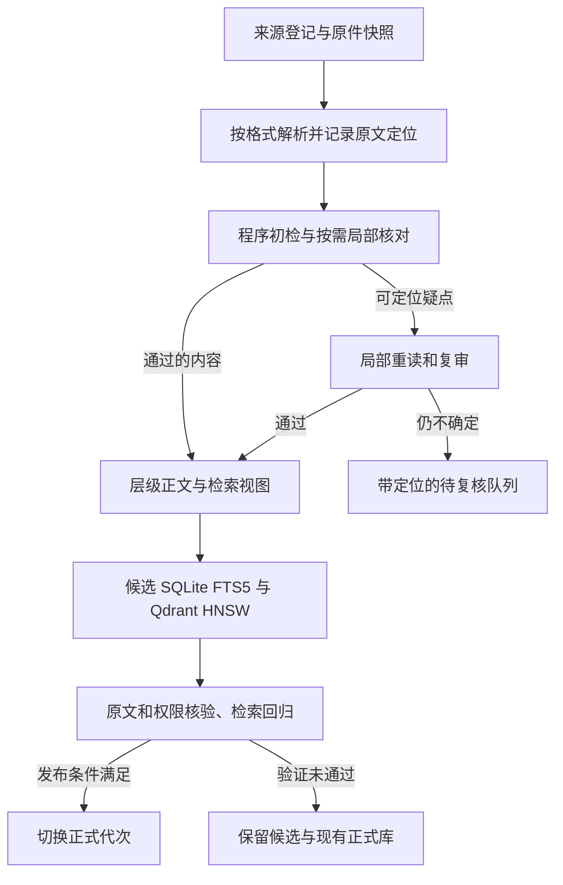
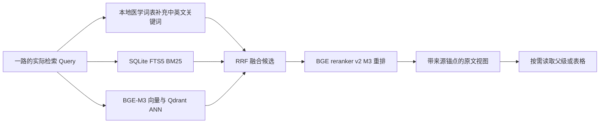

# 知识库入库与检索

[项目首页](../README.md) · [架构总览](ARCHITECTURE.md) · [Agent 工作流](AGENT_WORKFLOW.md) · [上下文预算](CONTEXT_BUDGETS.md)

本地知识库为肿瘤和综合疾病两条分析路线提供证据。它保存原件、解析后的层级和可复查的原文位置，同一份资料可以服务多个问题。患者上传的病历属于对应会话的病例原文，和正式医学知识库分开管理。

## 入库与受控发布

1. **来源登记**保存来源、原始文件、内容指纹和访问范围。检查点按资料记录阶段和失败原因。重跑时复用仍有效的解析、视图或向量，继续处理需要补做的阶段。嵌入模型发生变化时需要在独立工作区重建，保证一个索引使用同一向量空间。
2. **解析与层级**按资料格式读取标题、章节、正文、表格等内容。PDF 使用本地 MinerU，根据需要对疑点页重读或 OCR。解析产物保留能从来源得到的页码、源块、字符跨度或表格坐标。文档、章节、原文块和检索视图是不同层级，命中视图可回溯到它覆盖的原文。
3. **文本质量审核**先对解析产物做程序初检。普通原生文本出现疑似乱码、截断、顺序或覆盖异常时，按条件交给本地 4B 文本审核。可定位的问题执行受限的局部重读和复审，仍无法确认的内容进入待复核清单，保留原因和定位。能独立确认的内容继续处理。扫描件 OCR 按下述原页核对单独准入。
4. **生成检索视图**以可定位的原文跨度构建正文视图。活动配置将每条视图限制在 768 token，按嵌入 tokenizer 计数，文档标题和章节路径占用同一预算。长正文切出多个可回溯的视图，短块按原文结构保留。一期证据来自解析原文和来源字段，文件级生成摘要、逐块生成标签和全量知识图谱不作为必需入库步骤。
5. **构建与发布**在隔离的候选代次先构建全文和向量索引。发布前检查访问范围、原件与原文定位、向量绑定、旧来源连续性以及固定题检索结果。正式读取由活动代次指针控制，候选完成和正式发布分别记录。待复核资料和来源记录可继续追踪。

### 扫描件 OCR 原页核对

OCR v3 对同页的原句和几何位置进行比对，可保留核对稳定的含数字正文。遇到冲突时，只有存在独立的原文依据才更正。能独立定位的疑点按跨度暂扣，其余保留原块待复核。该支路由程序完成核对，原文、偏移和历史回执继续保留；4B 仍可用于普通原生文本疑点。通过核对的相邻 OCR 正文仅在同页、同章节且符合切分预算时合并，遇到标题、表格和待复核块即停止。

### 表格与图片

表格原件和结构信息保存在来源层。可靠的小表在表头、正文和相关注释能整体落入 768 token 时，可成为检索视图。大表只允许按来源结构把表头、脚注及互相依赖的行合成完整行组，单组仍须满足视图预算。无法确认表头、单位、脚注或行列关系的表格留待复核；图像和普通图注本身不建立正文检索视图。

检索命中相关正文后，可以按原文位置尝试读取合格的父级正文、整表或依赖完整的行组。若完整组件仍超预算，返回明确的省略信息，原表继续保留供核对。未确认来源关系的内容与普通预算超限分别记录。

### 资料复核时间

资料按文件记录来源明示的日期、精度与类型，检索视图继承相关字段。工程策略为指南和药品说明书设置 12 个月、临床研究 36 个月、综述和基础研究 60 个月的复核周期。已启用首次入库日期兜底的资料，在原始日期无法确认时，以首次入库日加 12 个月安排复核，并保留日期来源。引用到期资料时，报告提示核对更新版本，库中保留原文与历史版本。复核日期表示内部维护时间，不等同于临床有效期或已验证最新版。自动联网查新与替换在本页范围内尚未作为正式发布能力验收。

## 查询如何命中证据

BM25 依据词项匹配，适合核对专名、缩写和原文术语。医学词表在命中别名时补充中英文关键词，扩展结果只向候选池补入限量新视图。BGE-M3 从可访问的向量索引做跨语言语义召回。原始 BM25 和 Dense 候选通过 RRF 融合，BGE 重排器再对查询与完整检索视图打分。视图包含来源标题、章节路径和正文。搜索和证据回填都核对来源及其访问范围。

检索视图最多 **768 token**。常规搜索结果相关上下文预算为 **1,800 token**。Agent 发起主动原文读取时，配置允许单次 **4,096 token**，同章节父级范围最多 3 个相关块。长章节和有依赖的表格超出预算时按来源边界组织可用内容，并记录省略范围。这些上限分别约束检索、取证工具和模型输入，模型汇总、审核与溢出路径见[上下文预算](CONTEXT_BUDGETS.md)。

**合成例子。** 查询「指标甲的计量单位和原表定义在哪里」时，BM25 匹配指标名或缩写，Dense 补充语义相近的中英文段落。重排先返回写有该指标的视图。若命中段落把单位或定义放到同页脚注，则按来源锚点补读对应表格与注释。若该行的表头无法确认，报告继续使用已验证的正文，并标明表格定义未能核实。

## 最近核对结果

2026 年 11 月 15 日只读核对时，正式库有 **8,995 份已发布资料**、**542 份待复核资料**，ANN 代次记录 **372,689 条 1,024 维向量**。发布来源审计记录零错误和零旧来源缺失。64 道固定题的指定来源命中从 **59/64 降到 55/64**，严格自动门禁未通过。该代次随后经人工监督切换，记录了中查中、中查英、英查中、英查英四个方向的冒烟验证。上述核对范围为索引、来源和检索表现。

公开目录只展示可公开的来源信息，门户正文另行核对访问范围与再利用许可。单文件入库演示构建临时检索视图和一份隔离的 Qdrant HNSW 索引，试搜复用 BM25、BGE-M3、RRF 及 BGE 重排，按访客会话隔离并到期清理。正式档案和活动索引独立管理。公开合成 Markdown 验收中，上传生成 3 条检索视图，中英文查询均将对应章节排在首位并返回定位，缺少原会话时无法读取该任务。该测试覆盖演示链路与会话隔离。
